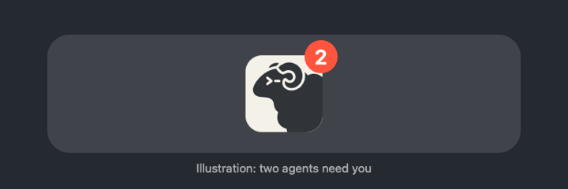

# Dock badge for Herdr

A [Herdr](https://herdr.dev) mod that puts the number of agents that need you on Herdr's Dock icon on macOS.



The preview is an illustration drawn from Herdr's app icon, not a screen capture.

- **Count:** top-level agents in status `blocked`. Sub-agents do not count.
- **Refresh:** every 2 seconds.
- **Zero:** the badge goes away.
- **Window:** the mod draws nothing. It lives in a 0px block.

It runs no programs, makes no network requests and writes no files. It reads only Herdr's own agent and terminal lists.

## Install

Ask your Herdr agent to add this mod from its https://herdr.dev/mods page, or from `https://github.com/mike-bronner/herdr-notification-badge`.

To install by hand:

```sh
git clone https://github.com/mike-bronner/herdr-notification-badge.git
cd herdr-notification-badge
[ -e ~/.config/herdr-app/mods/dock-badge ] && echo "exists: compare before installing" \
  || cp -R mods/dock-badge ~/.config/herdr-app/mods/dock-badge
herdr-app check ~/.config/herdr-app/mods/dock-badge
```

Herdr docks a 0px block for the mod into the layout you are showing. If you use other layouts, add this block to each one:

```json
{ "type": "block", "content": { "mod": "dock-badge" }, "size": { "px": 0 } }
```

To dock the block, Herdr wraps your layout's top node in a new row and column. The old top node's root-only settings (`titlebar`, `traffic_lights`, `terminal_padding`, `background`) then sit one level down, and Herdr ignores them. After the block appears, move those keys from the old `"id": "root"` node up to the new top node of the layout file.

## Limits

- macOS only. Other platforms have no Dock badge, so nothing shows.
- It only runs in layouts that contain its block.

## Verify changes

```sh
node --test tests/count.test.mjs
```

[RECIPE.md](RECIPE.md) is the build brief.

## License

MIT. See [LICENSE](LICENSE).
