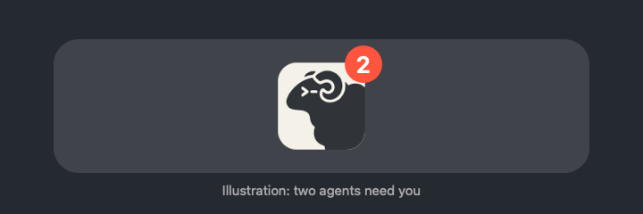

# Dock badge

Herdr's Dock icon shows how many agents need you. When an agent stops and waits for an answer, a red badge with the count appears on the Herdr icon in the macOS Dock. It updates every 2 seconds and goes away when no agent is waiting. Nothing changes inside the Herdr window.



## What you see

- **Nothing in the window.** The mod sits in a 0px block and draws one empty `div` with the id `dock-badge`.
- **A badge on the Dock icon** with the number of agents that need you, for example `2`. macOS draws the badge in its own style.
- **No badge** when no agent needs you.

## How it behaves

- **Blocked:** each top-level agent in status `blocked` adds one to the count.
- **Working, done, idle:** these agents do not count.
- **Sub-agents:** they never count, even when blocked. Their parent counts if it is blocked.
- **Other machines:** an agent on another machine (`vps/t7`) counts the same way as a local one.
- **Updates:** the count is read on every render and every 2 seconds, so it keeps working while the block is hidden. The badge is set only when the text changes.
- **Zero:** the badge is cleared.
- **Close:** when the mod's copy closes, it clears the badge.
- No clicks, keys or hovers. No sound and no notifications.

## Built from

- `mods/dock-badge/mod.json`: `{ "place": "bottom", "size": 0, "title": "Dock badge" }`. The first time Herdr sees the folder, it docks one 0px block with `content: { "mod": "dock-badge" }` into the shown layout.
- `count.js`: pure functions with no `herdr` import.
  - `needsYou(agents, terminals)`: the number of agents with `status === "blocked"` whose `address` is not the address of a terminal that has a `parent`. Missing lists and empty entries count as nothing.
  - `badgeText(count)`: `String(count)` above zero, else `null`.
- `main.js`: the `View`.
  - Reads `agents()` and `terminals()` from `herdr`.
  - Calls `setBadge(text)` when the text differs from the last one it set, and `setBadge(null)` in `close()`.
  - Starts `cx.timer.every(2000)` in `init`.
  - Returns early when `checking()` is true, so `herdr-app check` sets no badge and starts no timer.
- No props, keys, art, programs, network or file writes.

## Watch out

- `setBadge` works on macOS only. Other platforms ignore it, so the mod does nothing there.
- A mod only runs while a layout shows its block. A fresh copy docks into the layout shown when the folder first appears. Other layouts need the same 0px block added by hand: `{ "type": "block", "content": { "mod": "dock-badge" }, "size": { "px": 0 } }`.
- One block per layout is enough. A second copy sets the same badge.
- Docking wraps the layout's top node in a new row and column. Root-only settings (`titlebar`, `traffic_lights`, `terminal_padding`, `background`) then sit one level down and stop applying. Move those keys up to the new top node after the block docks.
- Use `terminals()` to find sub-agents. `agents()` has no `parent` field.
- If `agents()` or `terminals()` throws, that refresh is skipped and the last badge stays until the next good read.
- Do not call `setBadge` on every tick. Compare with the last text first.

## Done when

- `herdr-app check ~/.config/herdr-app/mods/dock-badge` passes.
- A fake agent in any tab goes blocked, then working:

  ```sh
  st() { printf '\033]7501;state=%s\033\\' "$1"; }; st working; sleep 4; st blocked; sleep 10; st working; sleep 600
  ```

  The Dock icon shows `1` within 2 seconds of `blocked`, and the badge clears within 2 seconds of `working`.
- Two blocked agents show `2`.
- A blocked sub-agent adds nothing.
- `node --test tests/count.test.mjs` passes: 6 tests.
